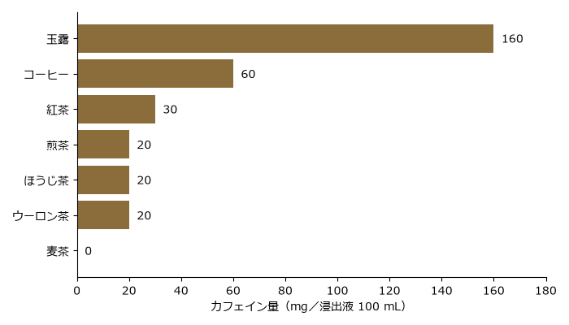

.. _chapter-health-safety:

茶外茶と健康・安全
==================

茶外茶は「健康茶」とも呼ばれ、健康によい飲み物として紹介されることが多い。この章では、カフェインの量の比較、健康効果の表示の読み方、安全に飲むために注意が必要なケースを説明する。

なお、本書は医学的な助言を目的としたものではなく、診断や治療の代わりになるものではない。茶外茶は食品であり、病気の治療や予防を目的とする医薬品ではない。体調や持病について不安がある場合は、医師や薬剤師に相談してほしい。

カフェインの量の比較
--------------------

\ :term:`カフェイン`\ には、眠気を覚ましたり、尿の量を増やしたりする作用がある。適量であれば問題はないが、とりすぎると、眠れなくなったり、気分が落ち着かなくなったりすることがある。

次の図は、チャノキの茶やコーヒーと、代表的な茶外茶である麦茶のカフェインの量を比較したものである。

   浸出液 100 mL あたりのカフェイン量（文部科学省「日本食品標準成分表」、厚生労働省「食品に含まれるカフェインの過剰摂取についてQ&A」をもとに作成）

麦茶をはじめ、茶外茶の大半はカフェインを含まない。ただし、マテ茶やグアユサ茶はカフェインを含む。また、ブレンド茶の中には、チャノキの葉を含むものがあるため、カフェインを避けたい場合は原材料表示を確認する（\ :numref:`chapter-choosing-storage`\ を参照）。

ノンカフェインであることの利点
------------------------------

カフェインを含まない茶外茶は、次のような人や場面でも飲みやすい。

* **就寝前**：カフェインは眠りを妨げることがあるため、夜はノンカフェインの茶外茶を選ぶとよい。
* **子ども**：子どもは大人に比べてカフェインの影響を受けやすいため、ノンカフェインの飲み物が向いている。
* **妊娠中・授乳中**：妊娠中や授乳中は、カフェインをとりすぎないことが勧められている。ノンカフェインの茶外茶は、カフェインを控えたいときの選択肢になる。ただし、後述するように、妊娠中や授乳中の安全性が十分に調べられていないハーブもある。

健康効果の表示の読み方
----------------------

日本では、食品に健康への効果を表示できるのは、国が定めた制度に基づく食品に限られている。茶外茶の製品にも、次のような制度に基づく表示がされたものがある。

.. list-table:: 健康に関する表示ができる食品の種類
   :header-rows: 1
   :widths: 22 78

   * - 種類
     - 説明
   * - :term:`特定保健用食品`
     - 「トクホ」とも呼ばれる。製品ごとに、効果や安全性について国の審査を受け、消費者庁長官の許可を受けたもの。許可された範囲で、「血糖値が気になり始めた方に」などの表示ができる
   * - :term:`機能性表示食品`
     - 事業者が、科学的な根拠を消費者庁長官に届け出て、自らの責任で機能性を表示するもの。国が個別に審査して許可したものではない
   * - :term:`栄養機能食品`
     - ビタミンやミネラルなど、国が定めた栄養成分を一定の量含む食品。国が定めた表現で栄養成分の機能を表示できる

これら以外の、いわゆる\ :term:`健康食品`\ には、健康への効果を表示することは認められていない。「健康茶」という名前で売られていても、特定の効果があることが確かめられているとは限らない。

また、特定保健用食品や機能性表示食品であっても、病気を治したり防いだりするものではない。表示されている摂取の目安を守り、多く飲めば効果が高まると考えないことが大切である。

注意が必要なケース
------------------

茶外茶の多くは、昔から飲まれてきたものであり、一般的な量を飲む限り問題は起こりにくい。しかし、次のような場合には注意が必要である。

アレルギー
~~~~~~~~~~

茶外茶の原料も食品であるため、アレルギーの原因になることがある。

* **そば茶**：そばは重いアレルギー症状を起こすことがある食品である。そばアレルギーの人は、そば茶や、そばを含むブレンド茶を飲んではいけない。
* **キク科の植物**：カモミール、菊花茶、たんぽぽ茶、ごぼう茶などは\ :term:`キク科`\ の植物から作られる。ブタクサやヨモギなど、キク科の植物の花粉にアレルギーがある人は、これらの茶外茶でアレルギー症状が出ることがある。
* **豆類**：黒豆茶の原料は大豆であるため、大豆アレルギーの人は注意する。
* **大麦**：麦茶の原料である大麦は、小麦とは別の植物だが、どちらもイネ科の近い仲間である。小麦アレルギーの人の中には大麦にも反応する人がいるため、小麦アレルギーがある人は、麦茶を飲んでよいか医師に相談する。

初めて飲む茶外茶で、口の中のかゆみや、じんましん、息苦しさなどの症状が出た場合は、飲むのをやめ、医師の診察を受ける。

甘草のとりすぎ
~~~~~~~~~~~~~~

\ :term:`甘草`\ （かんぞう）は、マメ科の植物の根で、砂糖の数十倍から 100 倍以上の甘さを持つ成分を含む。甘味料として、ブレンド茶やハーブティー、漢方薬などにも使われている。

甘草を長い期間、多くとり続けると、\ :term:`偽アルドステロン症`\ という症状が起こることがある。偽アルドステロン症では、体の中のカリウムが減ることによって、手足のだるさ、むくみ、血圧の上昇などが起こる。甘草を含む茶を毎日たくさん飲んだり、甘草を含む漢方薬と一緒に飲んだりすることは避ける。

下剤作用のある成分を含む製品
~~~~~~~~~~~~~~~~~~~~~~~~~~~~

センナ（マメ科の植物）の葉や果実には、腸を刺激しておなかをゆるくする強い作用を持つ成分が含まれており、日本では医薬品として扱われている。そのため、食品にはセンナの葉や果実を使うことはできず、作用の弱い茎だけが使われる。

しかし、過去には、「センナ茎」として売られていた茶に、医薬品として扱われる葉などが混ざっていた例が報告されている。おなかの調子を整えることをうたった茶外茶を飲んで、激しい腹痛や下痢が起きた場合は、飲むのをやめる。

また、ハブ茶の原料であるエビスグサの種子にも、おなかをゆるくする作用がある成分が含まれるため、一度にたくさん飲むことは避ける。

薬との飲み合わせ
~~~~~~~~~~~~~~~~

茶外茶の中には、薬の働きに影響を与えるものがある。よく知られた例が、セントジョーンズワート（和名セイヨウオトギリソウ）というハーブである。セントジョーンズワートは、体の中で薬を分解する働きを強めるため、一部の血液を固まりにくくする薬、免疫を抑える薬、経口避妊薬などの効き目を弱めることがある。

日常的に薬を飲んでいる人は、ハーブティーなどを習慣的に飲む前に、医師や薬剤師に相談する。

妊娠中・授乳中
~~~~~~~~~~~~~~

妊娠中や授乳中にカフェインを控えるために茶外茶を選ぶ人は多い。しかし、ハーブの中には、妊娠中や授乳中の安全性が十分に調べられていないものが多く、中には妊娠中に避けるよう注意を促す情報があるものもある。

妊娠中や授乳中は、麦茶など、昔から日常的に飲まれてきた茶外茶を適量飲むようにし、ハーブティーやブレンド茶を習慣的に飲む場合は、医師に相談するとよい。

非常に熱い飲み物
~~~~~~~~~~~~~~~~

マテ茶など、非常に熱い状態の飲み物をいつも飲むことは、食道がんのリスクを高める可能性があると指摘されている。これは茶外茶の成分ではなく、温度によるものと考えられている。熱い飲み物は、少し冷ましてから飲むとよい。

「健康によい」と「たくさん飲めばよい」は違う
--------------------------------------------

茶外茶の原料には、ポリフェノールなどの成分が含まれており、さまざまな健康への影響が研究されている。しかし、その多くは細胞や動物を使った実験であり、人が茶外茶を飲んだときに同じ効果があるとは限らない。

また、食品であっても、特定のものだけを大量にとり続けると、思わぬ健康上の問題が起こることがある。茶外茶は、日々の水分補給や楽しみのための飲み物として、さまざまな種類を適量ずつ取り入れるのがよい。

インターネットや広告で「病気が治る」「やせる」などの効果をうたう茶外茶を見かけたときは、次の点を確かめるとよい。

* その情報は、人を対象とした研究に基づいているか
* 研究の結果を大げさに伝えていないか
* 商品を売る目的の情報ではないか
* 特定保健用食品や機能性表示食品などの制度に基づいた表示か
