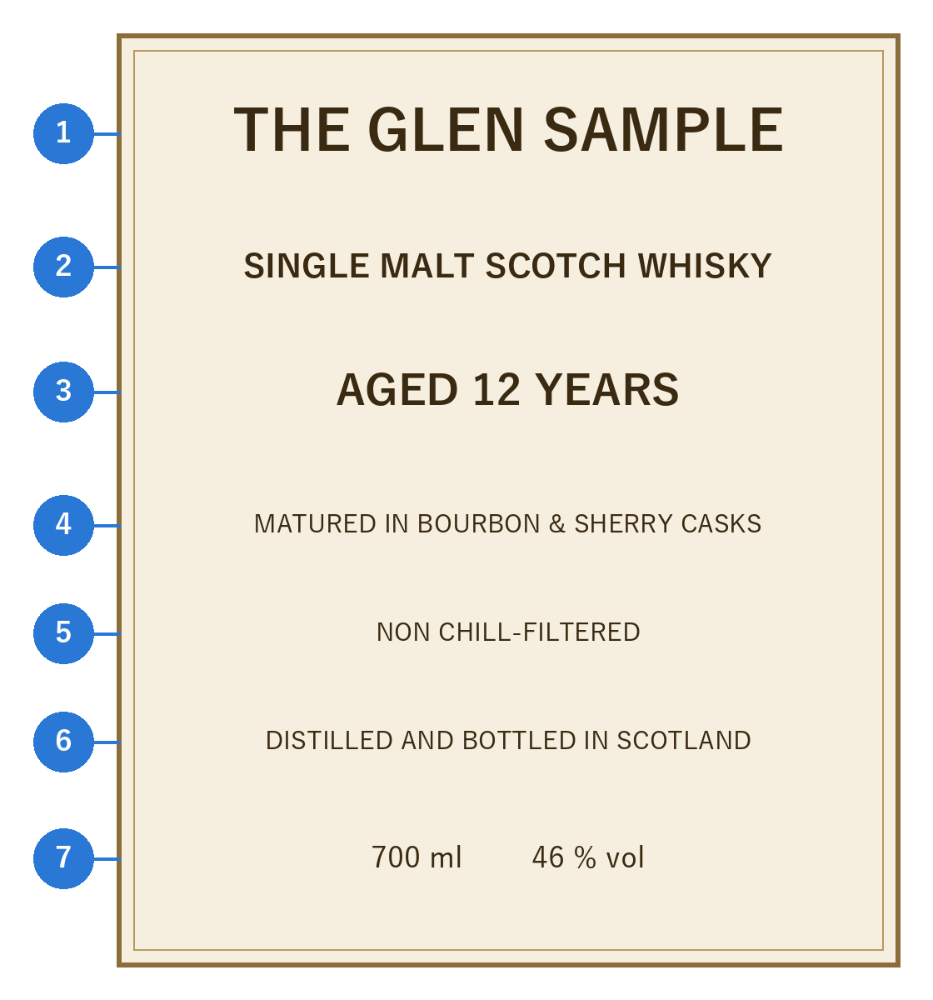

ウイスキーの種類
================

ウイスキーは、原料と製法によっていくつかの種類に分けられる。本章では、まず多くの産地で共通して使われる基本の分類を説明し、次にアメリカンウイスキーの分類と、ラベルの読み方を説明する。産地による分類は\ :doc:`04_regions`\ で扱う。

原料と製法による分類
--------------------

ウイスキーの基本は、次の 3 種類である。

* :term:`モルトウイスキー`\ ：大麦の麦芽だけを原料とし、主に単式蒸留器（ポットスチル）で蒸留したウイスキー。原料や蒸留所の個性が表れやすく、香味が豊かである。
* :term:`グレーンウイスキー`\ ：トウモロコシや小麦などの穀物を主な原料とし、連続式蒸留機で蒸留したウイスキー。軽やかでくせが少なく、主にブレンデッドウイスキーの材料として使われる。
* :term:`ブレンデッドウイスキー`\ ：モルトウイスキーとグレーンウイスキーを混ぜ合わせたウイスキー。飲みやすく、品質が安定しており、世界で最も多く飲まれている。

さらに、何をどう混ぜたかによって、\ :numref:`fig-types`\ のように細かく分かれる。

.. _fig-types:

.. graphviz::
   :caption: 原料と製法によるウイスキーの分類（スコッチの分類を基にしたもの）
   :align: center

   digraph types {
       rankdir=LR;
       graph [nodesep=0.25, ranksep=0.5, bgcolor="transparent"];
       node [shape=box, style="rounded,filled", fillcolor="#eef4fc", color="#2a78d6", fontsize=11, margin="0.15,0.08"];
       edge [color="#52514e"];

       whisky  [label="ウイスキー", fillcolor="#2a78d6", fontcolor="white"];
       malt    [label="モルトウイスキー\n（麦芽だけが原料）"];
       grain   [label="グレーンウイスキー\n（麦芽以外の穀物も使う）"];
       blended [label="ブレンデッドウイスキー\n（モルト＋グレーン）"];
       sm      [label="シングルモルト\n（1 つの蒸留所のモルトだけ）"];
       bm      [label="ブレンデッドモルト\n（複数の蒸留所のモルトを混ぜる）"];
       sg      [label="シングルグレーン\n（1 つの蒸留所のグレーンだけ）"];
       bg      [label="ブレンデッドグレーン\n（複数の蒸留所のグレーンを混ぜる）"];

       whisky -> malt;
       whisky -> grain;
       whisky -> blended;
       malt -> sm;
       malt -> bm;
       grain -> sg;
       grain -> bg;
   }

主な分類と表記を\ :numref:`table-type-terms`\ にまとめる。

.. _table-type-terms:

.. list-table:: 原料と製法による主な分類と表記
   :header-rows: 1
   :widths: 30 70

   * - 表記
     - 意味
   * - シングルモルト（Single Malt）
     - 1 つの蒸留所で造られたモルトウイスキーだけを使ったもの。その蒸留所の個性を味わえる。同じ蒸留所の中であれば、多くの樽の原酒を混ぜてもよい。
   * - ブレンデッドモルト（Blended Malt）
     - 複数の蒸留所のモルトウイスキーを混ぜたもの。グレーンウイスキーは含まない。かつては「ヴァッテッドモルト」「ピュアモルト」とも呼ばれた。日本では、現在も商品名に残っている（例：竹鶴 ピュアモルト）。
   * - シングルグレーン（Single Grain）
     - 1 つの蒸留所で造られたグレーンウイスキーだけを使ったもの。
   * - ブレンデッドグレーン（Blended Grain）
     - 複数の蒸留所のグレーンウイスキーを混ぜたもの。
   * - ブレンデッド（Blended）
     - モルトウイスキーとグレーンウイスキーを混ぜたもの。
   * - シングルカスク（Single Cask）
     - 1 つの樽の原酒だけを瓶に詰めたもの。樽ごとに味が異なり、本数も限られる。
   * - カスクストレングス（Cask Strength）
     - 加水せず、樽から出したときのアルコール度数のまま瓶に詰めたもの。アルコール度数は 50〜60 % 台になることが多い。

.. note::

   「シングル」は「1 つの蒸留所」を意味し、「1 つの樽」という意味ではない。1 つの樽だけを詰めたものは「シングルカスク」と呼ぶ。

アメリカンウイスキーの分類
--------------------------

アメリカでは、主に原料の穀物の割合と熟成の方法によってウイスキーを分類する。ライウイスキーのように、原料の 51 % 以上を占める穀物の名前で呼ぶものが多い。ただし、トウモロコシを 51 % 以上使い、内側を焦がした新しい樽で熟成させたものはバーボンと呼ぶ。主な種類を\ :numref:`table-american-types`\ に示す。詳しい規定は\ :doc:`04_regions`\ で説明する。

.. _table-american-types:

.. list-table:: アメリカンウイスキーの主な種類
   :header-rows: 1
   :widths: 25 35 40

   * - 種類
     - 主な原料
     - 特徴
   * - バーボン
     - トウモロコシ（51 % 以上）
     - 内側を焦がした新しいオーク樽で熟成させる。甘く華やかな香りが特徴。
   * - テネシーウイスキー
     - トウモロコシ（51 % 以上）
     - バーボンとほぼ同じ製法に加え、熟成前にサトウカエデの炭でろ過する。まろやかな味わいになる。
   * - ライウイスキー
     - ライ麦（51 % 以上）
     - スパイシーで、すっきりした味わい。カクテルにもよく使われる。
   * - コーンウイスキー
     - トウモロコシ（80 % 以上）
     - 熟成させないか、使用済みの樽や焦がしていない樽で熟成させる。素朴な穀物の香味がある。

ラベルの読み方
--------------

ウイスキーのラベルには、そのウイスキーの素性を知るための情報が書かれている。架空の銘柄のラベルを例に、主な項目を説明する（\ :numref:`fig-label`\ 、\ :numref:`table-label`\ ）。

.. _fig-label:

   ラベルの例（架空の銘柄）

.. _table-label:

.. list-table:: ラベルの項目と意味
   :header-rows: 1
   :widths: 8 32 60

   * - 番号
     - 表記
     - 意味
   * - 1
     - THE GLEN SAMPLE
     - 銘柄名。シングルモルトでは蒸留所の名前であることが多い。「GLEN」はゲール語で「谷」を意味し、スコットランドの蒸留所の名前によく使われる。
   * - 2
     - SINGLE MALT SCOTCH WHISKY
     - 種類と産地。この例では、スコットランドの 1 つの蒸留所で造られたモルトウイスキーであることを示す。
   * - 3
     - AGED 12 YEARS
     - 熟成年数。使われた原酒のうち、最も若いものが 12 年熟成であることを示す。
   * - 4
     - MATURED IN BOURBON & SHERRY CASKS
     - 熟成に使った樽。この例では、バーボン樽とシェリー樽で熟成させた原酒を使っている。
   * - 5
     - NON CHILL-FILTERED
     - 冷却ろ過をしていないこと（ノンチルフィルター）。
   * - 6
     - DISTILLED AND BOTTLED IN SCOTLAND
     - 蒸留と瓶詰めをスコットランドで行ったこと。
   * - 7
     - 700 ml、46 % vol
     - 容量とアルコール度数。

日本で販売されているウイスキーには、品目（ウイスキー）、アルコール分、内容量などを記した日本語のラベルが貼られている。原材料名として「モルト」「グレーン」などと書かれていれば、どの種類の原酒を使っているかが分かる。ただし、酒類は原材料名の表示が義務ではないため、記載のない製品もある。
