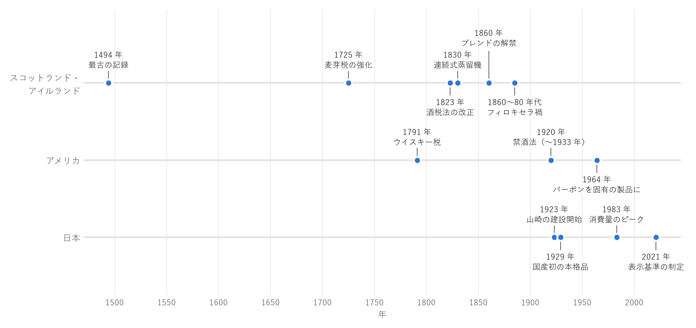

ウイスキーの歴史
================

本章では、ウイスキーの歴史の主な出来事を産地ごとに説明する。全体の流れを\ :numref:`fig-timeline`\ に示す。

.. _fig-timeline:

   ウイスキーの歴史の主な出来事

起源
----

蒸留の技術は、古代から中東などで香水や薬を造るために使われていた。この技術が中世にヨーロッパへ伝わり、修道院などで「命の水（アクア・ヴィテ）」と呼ばれる蒸留酒が造られるようになった。当初の蒸留酒は、薬として扱われていた。

ウイスキーがいつ、どこで生まれたかははっきりしていない。アイルランドとスコットランドの両方が発祥の地を名乗っている。文書に残る最古の記録は、1494 年のスコットランドの財務記録である。そこには、修道士ジョン・コーに「アクア・ヴィテを造るための麦芽」を支給したことが記されている。

当時の蒸留酒は、樽で熟成させずにそのまま飲む、無色透明のお酒だったと考えられている。

スコットランドとアイルランド
----------------------------

密造の時代
^^^^^^^^^^

17 世紀になると、ウイスキーは課税の対象となった。1707 年にスコットランドとイングランドが合同した後、1725 年には麦芽への課税が強化された。重い税を逃れるため、ハイランド地方の山奥などで密造が盛んに行われた。

密造者は、役人の目を逃れるため、ウイスキーを手近な樽に詰めて隠した。そのウイスキーを後で飲んでみると、琥珀色でまろやかな味わいに変わっていた。これが樽で熟成させる習慣の始まりだという言い伝えがある。

1823 年に酒税法が改正され、税金や免許の負担が軽くなると、密造者の多くが政府の免許を受けた正規の蒸留所となった。翌 1824 年には、ザ・グレンリベットが改正法の下での免許を取得している。

連続式蒸留機とブレンデッドウイスキー
^^^^^^^^^^^^^^^^^^^^^^^^^^^^^^^^^^^^

1830 年、アイルランドのイーニアス・コフィーが改良型の連続式蒸留機の特許を取得した。この蒸留機により、くせの少ないグレーンウイスキーを大量に、効率よく造れるようになった。

1860 年には、保税倉庫の中で異なる蒸留所のウイスキーを混ぜることが法律で認められた。個性の強いモルトウイスキーと、軽やかなグレーンウイスキーを混ぜた\ :term:`ブレンデッドウイスキー`\ は、飲みやすく品質も安定していたため、イングランドをはじめ広く受け入れられた。

フィロキセラ禍とスコッチの発展
^^^^^^^^^^^^^^^^^^^^^^^^^^^^^^

1860 年代以降、フィロキセラという害虫がフランスのブドウ畑に大きな被害を与えた（フィロキセラ禍）。被害は 1880 年代にかけて広がり、ワインやブランデーの生産が激減した。ブランデーに代わるお酒として、イギリスの上流階級の間でスコッチが飲まれるようになった。これをきっかけに、スコッチは世界に広まった。

アイリッシュウイスキーの衰退と復活
^^^^^^^^^^^^^^^^^^^^^^^^^^^^^^^^^^

19 世紀には、アイリッシュウイスキーが世界で最も飲まれていた。しかし、アイルランドの大手蒸留所の多くは、伝統的な単式蒸留器にこだわり、連続式蒸留機によるブレンデッドウイスキーの波に乗り遅れた。さらに 20 世紀に入ると、アイルランドの独立をめぐるイギリスとの対立や、最大の輸出先だったアメリカの禁酒法によって、輸出が大きく落ち込んだ。多くの蒸留所が閉鎖され、20 世紀後半には稼働する蒸留所はごくわずかになった。

その後、ジェムソンなどの銘柄が世界で人気を取り戻し、21 世紀に入ってからは新しい蒸留所が次々に開かれている。

アメリカ
--------

18 世紀、アメリカにはスコットランドやアイルランドからの移民が蒸留の技術を持ち込み、東部でライ麦を使ったウイスキーが造られた。

1791 年、独立戦争の負債を返すため、連邦政府はウイスキーに税をかけた。これに反発した農民たちが、1794 年に「ウイスキー反乱」と呼ばれる暴動を起こした。この前後から、課税を避けて西部へ移る蒸留業者も現れた。移った先のケンタッキー州などでは、豊富にとれるトウモロコシを原料にウイスキーが造られ、これがバーボンへと発展した。

1920 年から 1933 年までは禁酒法により、アメリカ国内でのお酒の製造・販売・輸送が禁止された。多くの蒸留所が廃業し、隣国のカナダからは大量のウイスキーが密輸された。禁酒法の廃止後、アメリカのウイスキー産業は復活した。1964 年には、アメリカ議会がバーボンを「アメリカ固有の製品」と認める決議を行い、国外で造られたものがバーボンを名乗れないようにした。

日本
----

日本人がウイスキーに触れたのは、江戸時代末期にペリーの艦隊が来航したときとされる。明治時代には輸入されたウイスキーや、アルコールに香料などを加えた模造品が飲まれていた。

1918 年、竹鶴政孝がウイスキーの製法を学ぶためにスコットランドへ渡った。竹鶴はグラスゴー大学で学び、現地の蒸留所で実習を積んで、1920 年に帰国した。

1923 年、寿屋（現在のサントリー）の鳥井信治郎が、大阪府の山崎で日本初の本格的なウイスキー蒸留所の建設を始めた。竹鶴は、その工場長として招かれた。1929 年には、国産初の本格ウイスキー「白札」が発売された。その後、竹鶴は独立し、1934 年に北海道の余市で蒸留所の建設を始めた（後のニッカウヰスキー）。

第二次世界大戦後、ウイスキーは高度経済成長とともに広く飲まれるようになった。トリスバーと呼ばれる大衆向けのバーが各地に生まれ、ウイスキーの水割りは日本独自の飲み方として定着した。国内のウイスキーの消費量は 1983 年にピークを迎えた後、長く減少が続いた。

2000 年代に入ると、日本のウイスキーが海外の品評会で高い評価を受けるようになった。2000 年代後半からはハイボールの人気が再び高まり、2014 年から 2015 年に放送された竹鶴夫妻をモデルとするテレビドラマ「マッサン」も話題を呼んだ。国内外での需要の急増により原酒が不足し、熟成年数を表記した製品の一部が販売を休止する事態も起きた。

2021 年には、日本洋酒酒造組合が「ジャパニーズウイスキー」の表示基準を定めた（\ :doc:`04_regions`\ を参照）。現在は、全国各地に新しい蒸留所が生まれている。
