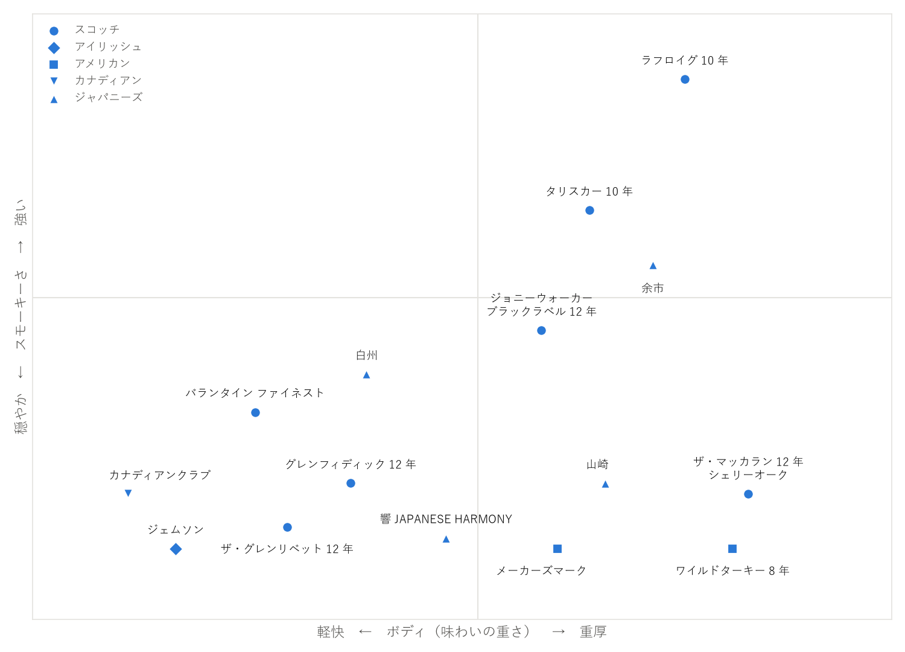

代表的な銘柄
============

本章では、日本で手に入りやすい定番の銘柄を産地ごとに紹介する。

.. note::

   * 銘柄の情報は 2026 年 10 月時点のものである。仕様の変更や販売の終了、品薄によって手に入りにくくなることがある。
   * 香味の説明とおすすめの飲み方は一般的な傾向を示した目安であり、感じ方には個人差がある。

初めての 1 本の選び方
---------------------

初めての人には、次の順に試すことを勧める。

1. **ブレンデッドウイスキーから始める**：飲みやすく手頃な価格のものが多い。まずはハイボールや水割りで、ウイスキーの香りに慣れるとよい。
2. **好みの方向を探る**：華やかでフルーティーなものが好きか、スモーキーなものが好きか、甘く濃厚なものが好きかを確かめる。
3. **シングルモルトで個性を楽しむ**：好みの方向が分かったら、その方向のシングルモルトを試す。

主な銘柄の香味の傾向を\ :numref:`fig-flavor-map`\ に示す。横軸は味わいの重さ（ボディ）、縦軸はスモーキーさの強さである。図の中で近くにある銘柄ほど、香味の傾向が似ている。

.. _fig-flavor-map:

   主な銘柄の香味の傾向（目安）

この図の位置は、一般的な評価を基にした目安であり、主観を含む。同じ銘柄でも、熟成年数や樽の違うものは香味が異なる。

スコッチ
--------

.. list-table:: スコッチのシングルモルト
   :header-rows: 1
   :widths: 22 18 42 18

   * - 銘柄
     - 地域
     - 特徴
     - おすすめの飲み方
   * - ザ・グレンリベット 12 年
     - スペイサイド
     - 青りんごや花のような華やかな香りで、軽やかな味わい。シングルモルトの入門に向く。
     - ストレート、ハイボール
   * - グレンフィディック 12 年
     - スペイサイド
     - 洋梨のような爽やかな果実の香り。三角形の瓶が特徴で、シングルモルトを世界に広めた先駆けとされる。
     - ストレート、ハイボール
   * - グレンモーレンジィ オリジナル
     - ハイランド
     - スコットランドで最も背が高いとされるポットスチルで蒸留する。柑橘や花の香りで、軽やかでなめらか。
     - ストレート、水割り
   * - ザ・マッカラン 12 年 シェリーオーク
     - スペイサイド
     - シェリー樽で熟成させ、ドライフルーツやスパイスのような濃厚な香りと、深い色を持つ。
     - ストレート
   * - タリスカー 10 年
     - アイランズ（スカイ島）
     - 潮の香りとスモーキーさ、黒こしょうのようなスパイシーな後味が特徴。
     - ハイボール、ストレート
   * - ラフロイグ 10 年
     - アイラ
     - ピートの香りがとても強く、薬品や海藻にたとえられる。好みが大きく分かれる個性派である。
     - ストレート、ハイボール

.. list-table:: スコッチのブレンデッドウイスキー
   :header-rows: 1
   :widths: 30 52 18

   * - 銘柄
     - 特徴
     - おすすめの飲み方
   * - ジョニーウォーカー ブラックラベル 12 年
     - 世界で最も売れているスコッチのブランド、ジョニーウォーカーの代表的な製品。ほどよいスモーキーさとコクがある。
     - ハイボール、オン・ザ・ロック
   * - シーバスリーガル 12 年
     - スペイサイドのモルトを中心とした、なめらかでまろやかな味わい。
     - 水割り、オン・ザ・ロック
   * - バランタイン ファイネスト
     - 軽やかでバランスがよく、手に取りやすい。
     - ハイボール、水割り
   * - ホワイトホース ファインオールド
     - アイラのモルトを使い、ほのかなスモーキーさがある。
     - ハイボール

アイリッシュ
------------

.. list-table:: アイリッシュウイスキー
   :header-rows: 1
   :widths: 30 52 18

   * - 銘柄
     - 特徴
     - おすすめの飲み方
   * - ジェムソン
     - 世界で最も売れているアイリッシュウイスキー。3 回蒸留による軽やかでなめらかな味わい。
     - ハイボール、ストレート
   * - ブッシュミルズ
     - 北アイルランドの蒸留所の製品。軽やかで、ほのかな蜂蜜のような甘さがある。
     - ハイボール、ストレート
   * - タラモアデュー
     - 3 回蒸留による、なめらかで穏やかな味わい。
     - ハイボール、水割り

アメリカン
----------

.. list-table:: アメリカンウイスキー
   :header-rows: 1
   :widths: 24 16 42 18

   * - 銘柄
     - 種類
     - 特徴
     - おすすめの飲み方
   * - ジムビーム
     - バーボン
     - 世界で最も売れているバーボンのブランド。軽やかで、ほのかに甘い。
     - ハイボール
   * - メーカーズマーク
     - バーボン
     - 原料にライ麦の代わりに冬小麦を使い、柔らかく甘い味わい。瓶の口の赤い封ろうが目印。
     - オン・ザ・ロック、ハイボール
   * - ワイルドターキー 8 年
     - バーボン
     - アルコール度数 50.5 %（101 \ :term:`プルーフ`\ ）の力強い味わい。濃厚な甘さとスパイシーさがある。
     - オン・ザ・ロック、ハイボール
   * - ジャックダニエル ブラック（Old No.7）
     - テネシーウイスキー
     - サトウカエデの炭でろ過した、まろやかな味わい。バニラやカラメルのような甘い香り。
     - コーラ割り、ハイボール

カナディアン
------------

.. list-table:: カナディアンウイスキー
   :header-rows: 1
   :widths: 30 52 18

   * - 銘柄
     - 特徴
     - おすすめの飲み方
   * - カナディアンクラブ
     - 軽やかで、くせが少ない。カクテルのベースとしても使いやすい。
     - ハイボール、カクテル
   * - クラウンローヤル
     - 1939 年のイギリス国王夫妻のカナダ訪問を記念して造られた。なめらかで甘い味わい。
     - オン・ザ・ロック、ハイボール

ジャパニーズ
------------

日本の銘柄は、近年の人気の高まりにより、品薄で手に入りにくいものや、販売を休止しているものがある。比較的手に入りやすいのは、角瓶やブラックニッカのようなブレンデッドウイスキーである。

.. list-table:: 日本のウイスキー
   :header-rows: 1
   :widths: 22 20 40 18

   * - 銘柄
     - 種類
     - 特徴
     - おすすめの飲み方
   * - 山崎
     - シングルモルト（大阪府）
     - 日本最初の本格的なウイスキー蒸留所の製品。ミズナラ樽を含む多彩な樽の原酒による、華やかで厚みのある味わい。
     - ストレート、水割り
   * - 白州
     - シングルモルト（山梨県）
     - 南アルプスの森の中にある蒸留所の製品。若葉のような爽やかな香りと、ほのかなスモーキーさがある。
     - ハイボール
   * - 余市
     - シングルモルト（北海道）
     - 石炭の直火で蒸留器を加熱する伝統的な製法を守る。力強い味わいとピートのスモーキーさがある。
     - ストレート、オン・ザ・ロック
   * - 宮城峡
     - シングルモルト（宮城県）
     - 華やかでフルーティーな、柔らかい味わい。
     - ストレート、水割り
   * - 響 JAPANESE HARMONY
     - ブレンデッド
     - 複数の蒸留所の原酒を合わせた、華やかで調和のとれた味わい。
     - ストレート、水割り
   * - 竹鶴 ピュアモルト
     - ブレンデッドモルト
     - 余市と宮城峡のモルトを合わせた、バランスのよい味わい。
     - ストレート、水割り
   * - 角瓶
     - ブレンデッド
     - 1937 年発売のロングセラー。甘い香りと厚みのある味わいで、ハイボールの定番である。
     - ハイボール
   * - ブラックニッカ クリア
     - ブレンデッド
     - ピートを使わないモルトを使った、くせのない軽やかな味わい。
     - ハイボール、水割り

山崎・白州・余市・宮城峡は、熟成年数を表記しない製品（ノンエイジ）を基本とする。山崎 12 年のように熟成年数を表記した製品もあるが、特に手に入りにくい。
