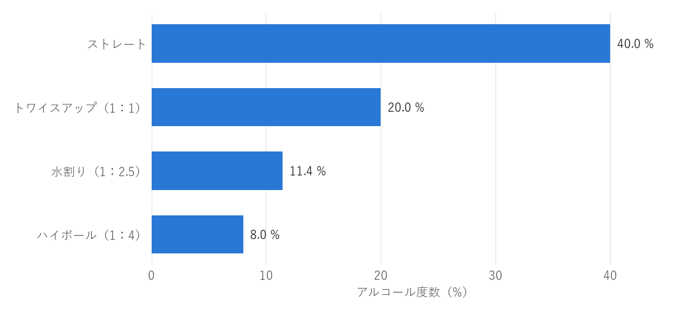

飲み方
======

ウイスキーは、飲み方によって香りの立ち方や味わいの印象が大きく変わる。決まった正解はないので、銘柄や気分、場面に合わせて選べばよい。本章では、主な飲み方とカクテルを紹介する。

主な飲み方
----------

主な飲み方の作り方と特徴を\ :numref:`table-drinking-styles`\ にまとめる。

.. _table-drinking-styles:

.. list-table:: 主な飲み方
   :header-rows: 1
   :widths: 18 44 38

   * - 飲み方
     - 作り方
     - 特徴
   * - ストレート
     - 氷や水を加えず、常温のままグラスに注ぐ。ニートとも呼ぶ。
     - ウイスキー本来の香りと味わいを最もよく感じられる。アルコール度数が高いので、チェイサー（水）を用意し、少量ずつ飲む。
   * - トワイスアップ
     - ウイスキーと常温の水を 1：1 で合わせる。
     - アルコールの刺激が和らぎ、香りが開きやすい。ブレンダーが原酒の香りを確かめるときにも使う方法である。
   * - オン・ザ・ロック
     - ロックグラスに大きな氷を入れ、ウイスキーを注ぐ。
     - 冷たくすっきりした味わい。氷が溶けるにつれて、味わいが変わっていくのを楽しめる。
   * - ハーフロック
     - 氷を入れたグラスに、ウイスキーと水を 1：1 で注ぐ。
     - オン・ザ・ロックより飲みやすく、水割りより香りや味わいがしっかり残る。
   * - 水割り
     - 氷を入れたグラスに、ウイスキーと水を 1：2〜2.5 で注ぐ。
     - 食事に合わせやすい、日本で広く親しまれている飲み方。
   * - ハイボール
     - 氷を入れたグラスに、ウイスキーと炭酸水を 1：3〜4 で注ぐ。
     - 爽快で飲みやすい。食事との相性がよい。
   * - お湯割り
     - ウイスキーとお湯を 1：2〜3 で合わせる。
     - 香りが立ち、体が温まる。寒い季節に向く。
   * - ミスト
     - グラスに細かく砕いた氷を詰め、ウイスキーを注ぐ。レモンの皮をしぼって香りを付けることもある。
     - グラスの表面が霧（ミスト）のように曇ることが名前の由来。キリッと冷えた味わいになる。

初めての人は、アルコール度数が低く飲みやすいハイボールや水割りから始めるとよい。慣れてきたら、トワイスアップやストレートで、銘柄ごとの香りの違いを楽しむとよい。

おいしく作るコツ
----------------

ハイボール
^^^^^^^^^^

1. グラスに氷をいっぱいに入れ、マドラーで混ぜてグラスを冷やす。溶けた水は捨てる。
2. ウイスキーを注ぎ、よく混ぜて冷やす。
3. よく冷えた炭酸水を、氷に当てないように静かに注ぐ。
4. マドラーで縦に 1 回だけ軽く混ぜる。混ぜすぎると炭酸が抜ける。

好みでレモンの皮をしぼったり、黒こしょうを振ったりしてもよい。

水割り
^^^^^^

1. グラスに氷をいっぱいに入れ、ウイスキーを注ぐ。
2. マドラーでよく混ぜ、ウイスキーを冷やす。
3. 氷を足し、冷えた水を注ぐ。
4. もう一度軽く混ぜる。

水は、ミネラル分の少ない軟水を使うと、ウイスキーの香りを邪魔しにくい。

お湯割り
^^^^^^^^

先にお湯をグラスに入れ、後からウイスキーを注ぐ。こうすると対流で自然に混ざり、香りも立ちやすい。お湯は、沸騰したものを少し冷ました 70〜80 ℃ 程度がよい。熱すぎるとアルコールの刺激が強く感じられる。

飲み方とアルコール度数
----------------------

水や炭酸水で割ったときのアルコール度数は、次の式で計算できる。

.. math::

   p = \frac{V_w \times a}{V_w + V_m}

ここで、\ :math:`p`\ は割った後のアルコール度数（%）、\ :math:`V_w`\ はウイスキーの量（ml）、\ :math:`a`\ はウイスキーのアルコール度数（%）、\ :math:`V_m`\ は割り材の量（ml）である。

たとえば、アルコール度数 40 % のウイスキー 30 ml を炭酸水 120 ml で割ると、アルコール度数は次のようになる。

.. math::

   p = \frac{30 \times 40}{30 + 120} = 8

つまり、アルコール度数 8 % 程度のハイボールになる。実際には、溶けた氷の水も加わるため、これより少し低くなる。アルコール度数 40 % のウイスキーを主な飲み方で割ったときの目安を\ :numref:`fig-abv-by-style`\ に示す。

.. _fig-abv-by-style:

   飲み方ごとのアルコール度数の目安（アルコール度数 40 % のウイスキーの場合、氷が溶けた分は含まない）

ハイボール（8〜10 % 程度）は、ビール（5 % 程度）よりアルコール度数が高い。水割り（11〜13 % 程度）は、ワイン（12 % 程度）とほぼ同じである。飲みやすいからといって飲み過ぎないよう注意する。

ウイスキーを使ったカクテル
--------------------------

ウイスキーは、カクテルのベースとしても広く使われる。代表的なカクテルを\ :numref:`table-cocktails`\ に示す。分量は一般的な例であり、店やレシピによって異なる。

.. _table-cocktails:

.. list-table:: ウイスキーを使った代表的なカクテル
   :header-rows: 1
   :widths: 20 45 35

   * - カクテル
     - 材料と作り方（例）
     - 特徴
   * - マンハッタン
     - ライウイスキーまたはバーボン 45 ml、スイートベルモット 15 ml、アンゴスチュラ・ビターズ 1 ふりを氷と混ぜて冷やし、カクテルグラスに注ぐ。チェリーを飾る。
     - 「カクテルの女王」と呼ばれる。甘く香り高い。
   * - オールドファッションド
     - ロックグラスに角砂糖 1 個とビターズを入れて潰し、氷とバーボンまたはライウイスキー 45 ml を加える。オレンジの皮などを添える。
     - 最も古いカクテルの 1 つとされる。砂糖を崩しながら甘さを調節して飲む。
   * - ミントジュレップ
     - グラスでミントの葉と砂糖を軽く潰し、細かく砕いた氷とバーボン 60 ml を加えて混ぜる。
     - アメリカの競馬、ケンタッキーダービーの公式ドリンクとして知られる。爽やかな味わい。
   * - ウイスキーサワー
     - ウイスキー 45 ml、レモン果汁 20 ml、砂糖 1 さじをシェークし、グラスに注ぐ。
     - 甘酸っぱく飲みやすい。
   * - ゴッドファーザー
     - 氷を入れたロックグラスに、スコッチ 45 ml とアマレット（杏仁の香りのリキュール）15 ml を注いで混ぜる。
     - 甘く香ばしい香り。食後に向く。
   * - ラスティネール
     - 氷を入れたロックグラスに、スコッチ 45 ml とドランブイ（スコッチを使ったハーブと蜂蜜のリキュール）15 ml を注いで混ぜる。
     - 甘く濃厚な味わい。食後に向く。
   * - アイリッシュコーヒー
     - 温めたグラスに砂糖と熱いコーヒーを入れ、アイリッシュウイスキー 30 ml を加える。軽く泡立てた生クリームを浮かべる。
     - 温かく、コーヒーとウイスキーの香りが合う。寒い季節に向く。
